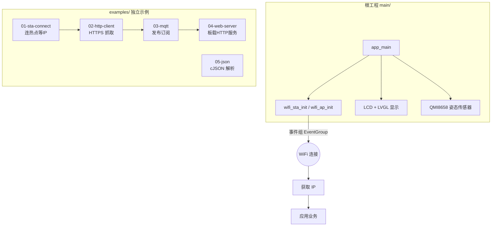

# ESP32-S3 WiFi Station 联网工程与示例集

一个 **ESP32-S3 + ESP-IDF** 的 WiFi 联网仓库：根目录是一个集成了 **LCD(LVGL) + 姿态传感器(QMI8658) + WiFi STA/AP** 的综合应用，并附带 5 个**独立可编译**的联网示例，覆盖从"连上热点"到"跑 HTTP/MQTT/Web 服务器/JSON"的完整链路。

## 系统架构



## 目录

| 路径 | 说明 |
|---|---|
| `main/` + `components/` | **综合应用**：WiFi STA/AP、事件组同步、LVGL 显示屏、QMI8658 六轴 IMU |
| `components/WIFI/wifi_sta.c` | STA 模式：注册 `WIFI_EVENT` / `IP_EVENT`，拿到 IP 后通过回调置位事件组 |
| `components/WIFI/wifi_ap.c` | AP 模式：板子自身做热点（默认关闭，见 `main.c` 注释） |
| `examples/01-sta-connect` | 最小可运行：STA 连接 + 事件组等待 IP |
| `examples/02-http-client` | 联网后 HTTPS 抓取网页 |
| `examples/03-mqtt` | 连接公共 broker，定时发布 + 订阅 `swd/test` |
| `examples/04-web-server` | 板子起 HTTP 服务器，访问 `/` 返回页面 |
| `examples/05-json` | 用 cJSON 构造 / 解析 JSON（无需联网） |

## 构建与运行

```bash
# 根工程（综合应用）
. $HOME/esp/esp-idf/export.sh
cd esp32-wifi-station
idf.py set-target esp32s3
idf.py build flash monitor

# 任一示例
cd examples/03-mqtt
idf.py set-target esp32s3
idf.py build flash monitor
```

> 联网示例需在 `main.c` 中把 `EX_SSID` / `EX_PASS` 改成你的热点账号。

## 核心设计（面试可讲）

1. **事件组做连接同步**：根工程 `main.c` 不轮询 WiFi 状态，而是把回调 `wifi_event_handler` 注册给 WiFi 组件，连接成功时 `xEventGroupSetBits()` 通知应用任务 `xEventGroupWaitBits()` 放行——联网快就早跑、慢也不误判。
2. **STA/AP 双模式可切换**：`wifi_sta.c` / `wifi_ap.c` 分别实现，根工程默认 STA，AP 代码保留作对照（注释关闭）。
3. **端到端联网范式**：`examples/` 从"连上 WiFi"逐层叠加 HTTP / MQTT / Web 服务，体现了嵌入式设备接入物联网云平台的典型路径。
4. **数据交换用 JSON**：`examples/05-json` 演示 cJSON，便于与云端/上位机做结构化通信。

## 扩展方向

- `03-mqtt` 接入华为云 / 阿里云 MQTT（三元组鉴权）
- `04-web-server` 增加 REST 接口控制 GPIO
- 根工程把 IMU 姿态数据经 MQTT 上报，形成"端—云"闭环

## License

[MIT](LICENSE)
